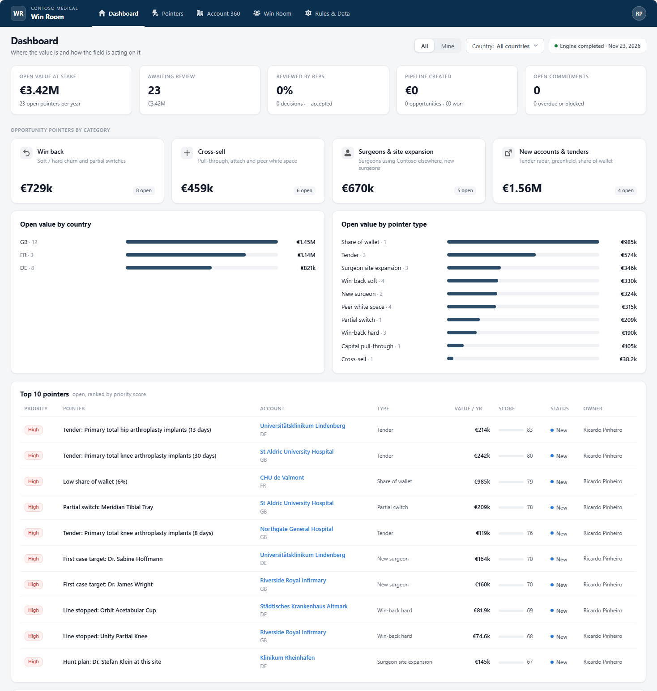
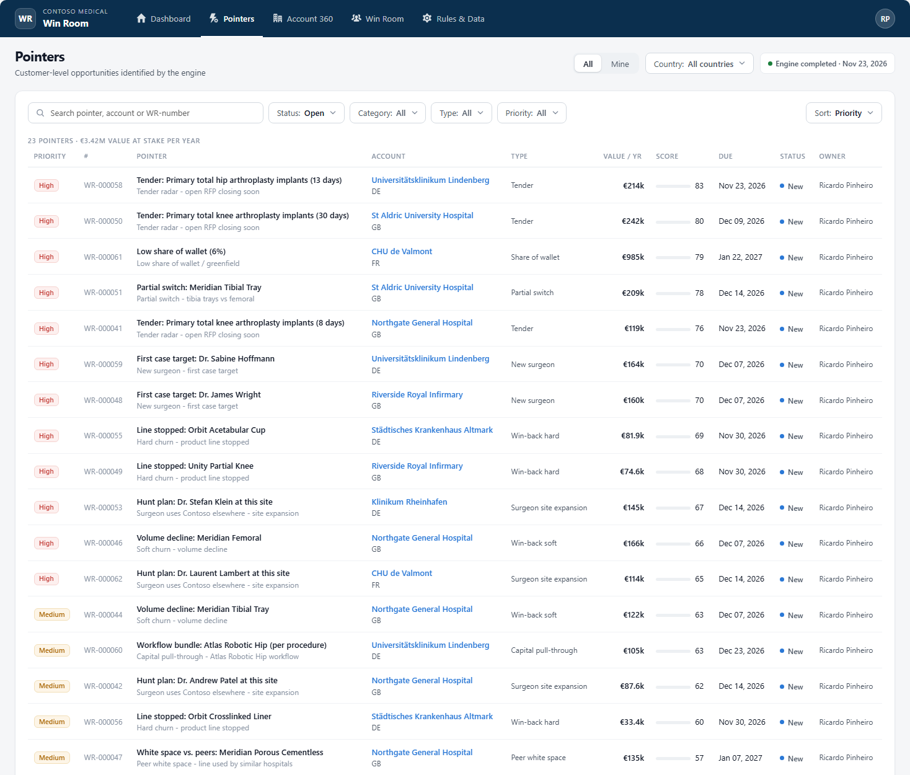
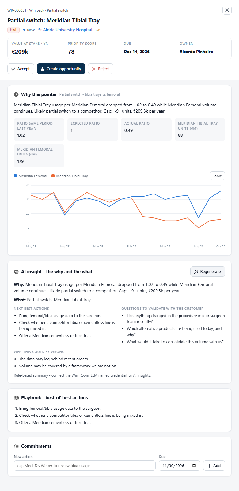
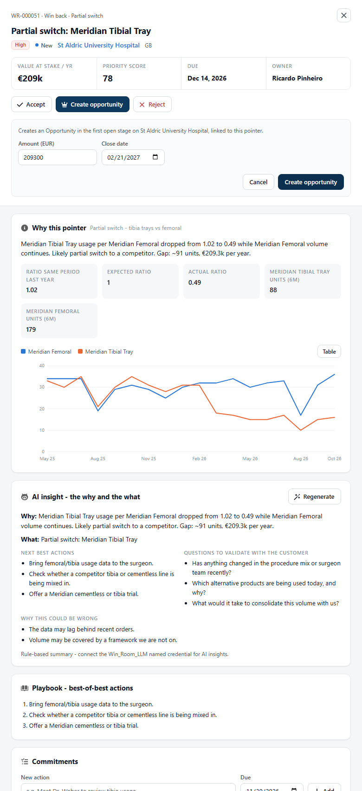
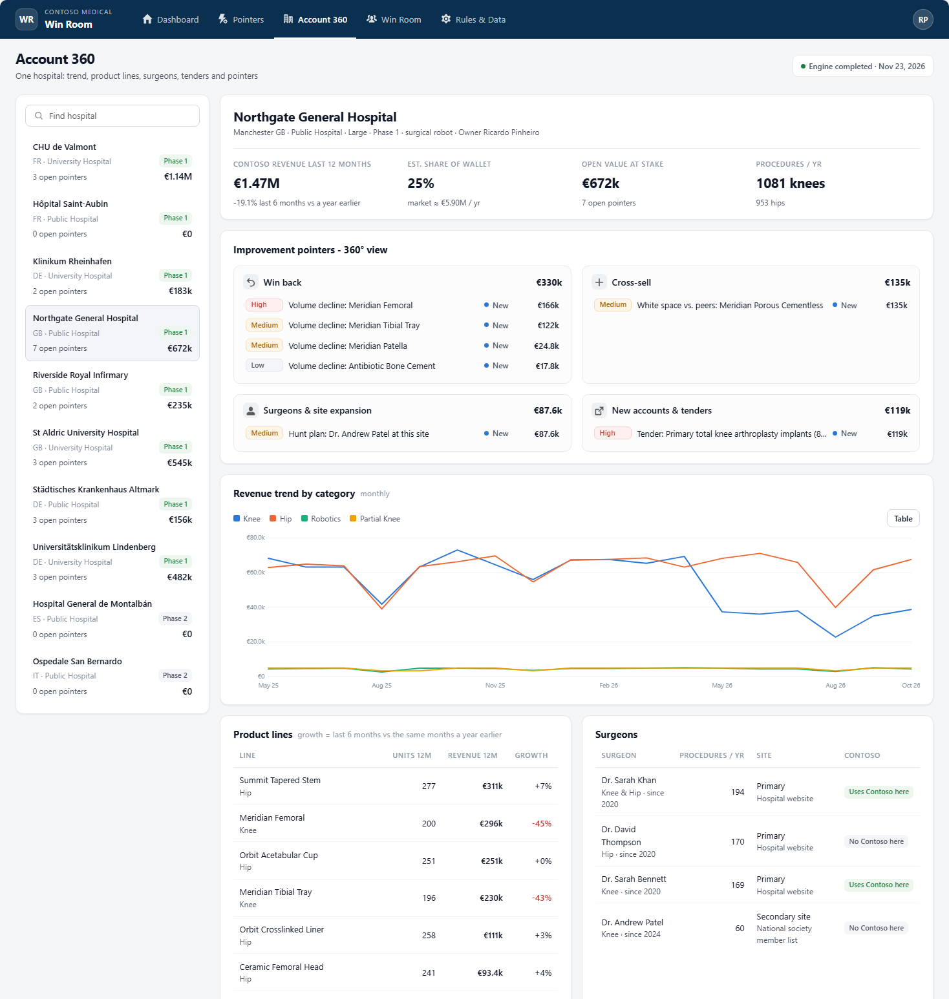
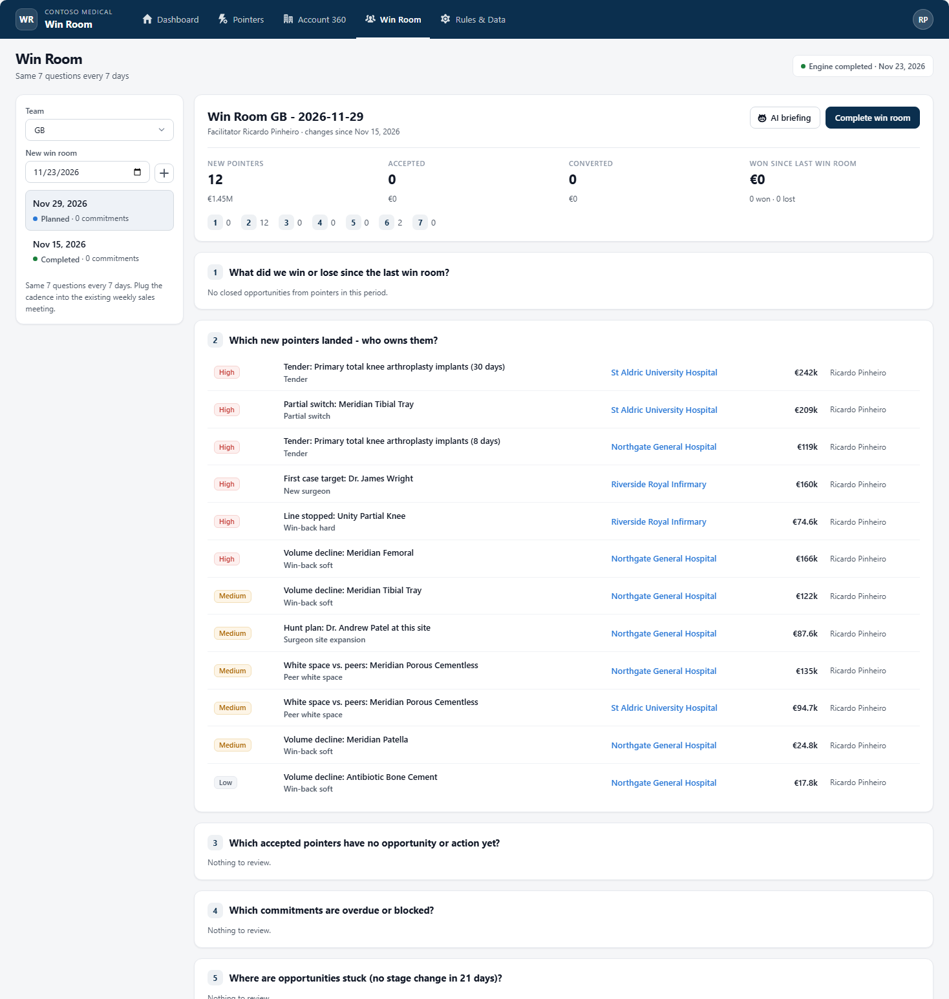
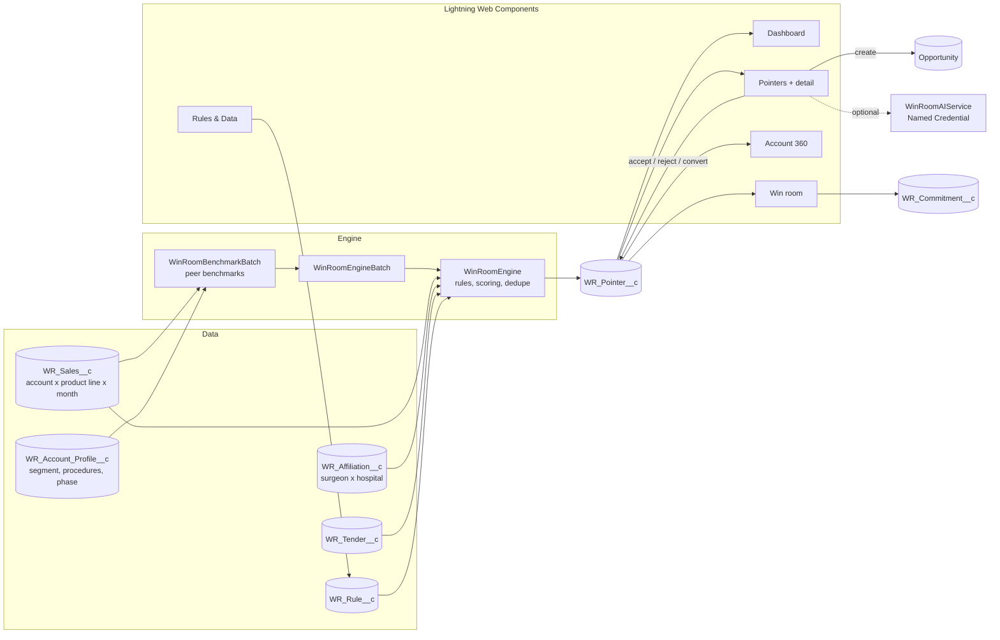

# Salesforce Win Room

A **win room** for field sales, built natively on Salesforce with Apex and Lightning Web Components. A rules engine reads monthly sell-in and finds **customer-level opportunities** ("pointers"). Reps review them with the numbers behind each one and an optional AI summary, then accept, reject or turn them into Opportunities. A **weekly win room** asks the same 7 questions every 7 days, so the opportunities turn into committed actions.

This is a neutral open-source reference with fictitious data. The demo domain is orthopaedic implants (knees, hips, surgical robots) sold to hospitals, but the engine, the data model and the portal are generic.

| Module | What it shows |
| --- | --- |
| **Rules engine** | 13 configurable rules in 9 types, in four categories: **win back** (soft / hard churn, partial switch to a competitor), **cross-sell** (component pull-through, capital pull-through, white space vs. peer hospitals), **surgeons & site expansion** (surgeon uses us at another hospital, new surgeon) and **new accounts & tenders** (tender radar, low share of wallet / greenfield). Two batches (peer benchmarks, then evaluation) scale to large customer bases. |
| **Explainable pointers** | Every pointer stores the facts that triggered it, a monthly chart and a plain-language rationale. Value at stake and a 0–100 priority score (value, rule weight, urgency) rank the work. There is **one pointer per customer × product**, and a specific signal always beats the generic peer comparison. |
| **Safe re-runs** | Pointers are matched on a signature. Re-running the engine updates the numbers but **never overwrites a rep's decision**, and undecided pointers that are no longer detected expire. |
| **Activation** | Accept, reject with a reason (the dashboard shows the acceptance rate per rule, a feedback loop for tuning), or create an Opportunity in the org's first open stage, linked to the pointer. |
| **AI "why and what"** | Optional. An OpenAI-compatible model, reached through a **Named Credential** (`Win_Room_LLM`), writes the why, the what, next best actions, talking points, discovery questions and risks, plus a briefing for the win room facilitator. Without it, a rule-based summary is shown, so nothing breaks. |
| **Weekly win room** | Sessions per team, with the 7 questions: wins and losses, new pointers, accepted pointers without action, overdue commitments, stuck opportunities, tenders closing soon, and commitments for next week. |
| **Admin without code** | Thresholds, windows, product lines and playbooks are edited in the portal. The engine runs on demand, account scope is set per rollout phase, and demo data can be generated and purged. |
| **Neutral UI** | Custom dropdowns, switches and buttons render the same in every org, whatever the org's brand colour. The portal runs as a Lightning tab or full screen on an Experience Cloud (LWR) site. |

## Screenshots

Captured in a Developer Edition org with the demo data (fictitious hospitals, surgeons and products).

| | |
| --- | --- |
|  Dashboard: value at stake, the four categories, value by country and type, top 10 |  Scope switch and country filter |
|  Pointers: search, filters, priority score, due dates |  Pointer: rationale, facts, monthly chart, AI insight, playbook, commitments |
|  Create an Opportunity from an accepted pointer |  Account 360: revenue trend, pointers by category, product lines, surgeons |
|  Weekly win room: same 7 questions every 7 days |  Rules: thresholds, windows, product lines, playbooks |
|  Data: demo data, purge and account scope by rollout phase | |

## How it works



1. **Identify.** The engine compares each in-scope account with its own history and with peer hospitals of the same segment, and writes pointers with value at stake, priority and evidence.
2. **Activate.** Reps review pointers in the portal (or in an activation workshop), accept or reject them and create Opportunities.
3. **Execute.** The weekly win room reviews progress with the 7 questions and records commitments with an owner and a due date.

More detail is in [docs/architecture.md](docs/architecture.md) and [docs/rules.md](docs/rules.md).

## Install in a Developer Edition org

```bash
sf org login web -a win-room
sf project deploy start -o win-room -d force-app -l RunSpecifiedTests -t WinRoomTest
sf org assign permset -o win-room -n Win_Room_Admin
sf apex run -o win-room -f scripts/apex/seed-demo-data.apex
```

Open the **Win Room** app. The seed creates 10 fictitious hospitals and runs the engine; pointers appear after 1–2 minutes (the header shows the engine status).

- **Reps** get `Win_Room_User` (review pointers, decide, run win rooms). **Admins** get `Win_Room_Admin` (rules, engine runs, demo data, scope).
- **Storage.** A Developer Edition org has 5 MB of data. The demo generator detects it and switches to compact mode (18 months of history, about 2,000 sales rows). Other orgs get 24 months.
- **AI (optional).** Create an External Credential with your API key and a Named Credential called `Win_Room_LLM` pointing at an OpenAI-compatible API (for example `https://api.openai.com`), and give users access to the principal. No key is stored in this repository.
- **Portal.** Add the `winRoomApp` component to an LWR Experience Cloud page and set *Full screen* to show it as a standalone portal.

## Demo script (10 minutes)

1. **Dashboard.** This is the bottom-up map of opportunities: value at stake, the four categories, value by country and by type, and the top 10.
2. **Pointers.** Filter *Type: Partial switch* and open **Partial switch: Meridian Tibial Tray**.
   - The rationale and the chart show tibial trays dropping while femoral volume continues.
   - **Generate AI insight** adds the why, the what, next best actions, questions and risks.
   - **Accept**, then **Create opportunity**: the Opportunity is linked to the pointer.
3. **Account 360.** Open **Northgate General Hospital** to see soft churn on the knee lines, a surgeon to hunt, a tender closing soon and white space vs. peers.
4. **Win room.** Team **GB**, planned session.
   - Walk through the 7 questions and add a commitment with an owner and a due date.
   - **AI briefing** prepares the facilitator.
5. **Rules & Data.**
   - Change *Soft churn* from 25% to 30%, then **Run engine now**: decisions are kept and pointers update.
   - Show the account scope by rollout phase.

Reset before a demo: **Rules & Data → Data → Purge demo data**, then **Generate demo data**.

[docs/presentation.md](docs/presentation.md) has a talk track for presenting the project.

## Tests

- **Apex:** 12 tests in `WinRoomTest`, run as a user with the `Win_Room_Admin` permission set, so user-mode access is tested too. All passed in a Developer Edition org on 23 Nov 2026 (classes 87–100% covered). They plant every pattern, run the engine and check that each pointer type is found, that re-runs keep decisions and create no duplicates, the pointer lifecycle, the win room agenda and the AI parsing (mocked callout) and fallback.
- **JavaScript:** `npm test` runs Jest on `winRoomUtils` and `winRoomSelect` (12 tests). `npm run lint` runs ESLint.
- **CI:** every push runs ESLint and Jest. To run the Apex tests too, add a repository secret `DEVHUB_SFDX_AUTH_URL` with the *Sfdx Auth Url* of a Dev Hub. The job then creates a one-day scratch org, deploys, runs the tests and deletes the org.

## Project structure

```
force-app/main/default/
  classes/           WinRoomEngine (rules, scoring), WinRoomBenchmarkBatch, WinRoomEngineBatch,
                     WinRoomRules (defaults), WinRoomController (portal API), WinRoomAIService,
                     WinRoomMockData + WinRoomMockDataBatch (demo data), WinRoomTest
  lwc/               winRoomApp (shell) and the views: winRoomDashboard, winRoomPointers,
                     winRoomPointerDetail, winRoomAccount360, winRoomSession, winRoomAdmin;
                     shared: winRoomSelect, winRoomSegmented, winRoomLineChart, winRoomUtils, winRoomStyles
  objects/           WR_Sales__c, WR_Product_Line__c, WR_Account_Profile__c, WR_Surgeon__c, WR_Affiliation__c,
                     WR_Tender__c, WR_Rule__c, WR_Run__c, WR_Pointer__c, WR_Session__c, WR_Commitment__c
  permissionsets/    Win_Room_User, Win_Room_Admin
  customPermissions/ Win_Room_Admin
  applications/ tabs/
scripts/apex/        seed-demo-data.apex
docs/                architecture, rules, presentation
```

## License

MIT. See [LICENSE](LICENSE).
